# F4.10 — Simulação ponta a ponta do pagamento (provedor em modo teste)

Tudo roda no `TestClient` com repositórios em memória e o `ProvedorFake`. Nenhuma chamada de rede,
nenhum banco real. Testes: `backend/tests/api/test_fluxo_pagamento_e2e.py` (24 casos),
`test_pagamentos_provedor.py`, `test_pagamentos_taxa.py`.

## O que foi entregue

| Peça | Onde |
|---|---|
| Interface `ProvedorPagamento` (criar cobrança Pix/cartão, consultar, estornar, validar webhook) | `pagamentos/provedor/base.py` |
| `ProvedorFake` (determinístico; eventos assinados com segredo de teste) | `pagamentos/provedor/fake.py` |
| `ProvedorStripeTeste` (só `sk_test_`; transporte injetado; testado com respostas simuladas) | `pagamentos/provedor/stripe_teste.py` |
| Regra única de taxa (bps + mínimo em centavos; progressiva desligada) | `pagamentos/taxa.py` |
| Orquestrador (cobrança, webhooks, ledger espelhado, estorno, aditivo) | `pagamentos/orquestrador.py` |
| Rotas novas: cobrança, aditivo, decisão da disputa | `api/rotas_pagamento.py` |
| Único ajuste em código existente: gancho `Contexto.apos_transicao`, chamado em `mudar_estado` | `api/contexto.py`, `api/rotas_pedidos.py` |

Ligação: `instalar_pagamento(app, contexto, ServicoPagamento(provedor, config, repos...))`.
O segredo do webhook do `Contexto` passa a ser o do provedor.

## Estados percorridos

```mermaid
stateDiagram-v2
    [*] --> Aberto: cliente abre (POST /pedidos)
    Aberto --> OrcamentoAceito: aceite (contrato congela taxa)
    OrcamentoAceito --> PagoERetido: webhook ASSINADO "pago" (1x; reenvio ignorado)
    OrcamentoAceito --> OrcamentoAceito: cobrança criada / pagamento falhou (nova tentativa)
    OrcamentoAceito --> Aberto: prazo do pagamento (rotina); pagamento tardio é devolvido
    OrcamentoAceito --> Cancelado: cliente cancela (cobrança cancelada)
    PagoERetido --> Agendado: profissional confirma agenda (gera código de início)
    PagoERetido --> Cancelado: cancelamento (estorno total)
    Agendado --> Cancelado: cancelamento (estorno total)
    Agendado --> EmAndamento: check-in com código
    EmAndamento --> EmAndamento: aditivo proposto -> aprovado -> pago
    EmAndamento --> EmConfirmacao: check-out com código
    EmConfirmacao --> Concluido: cliente confirma (ledger reparte: retenção + taxa)
    EmConfirmacao --> EmDisputa: cliente abre (valor congelado)
    EmDisputa --> Concluido: liberar tudo / parcial / acordo
    EmDisputa --> Cancelado: reembolso total
    EmDisputa --> Retrabalho: nova visita
    Concluido --> Retrabalho: garantia
    Retrabalho --> EmConfirmacao: check-out
    Concluido --> [*]: webhook de liquidação libera "a liberar" -> "liberado"
```

Ledger no caminho feliz (R$ 1.000,00, taxa 7,5% só no teste):
`cobrança` (cliente→custódia, no webhook) → `retenção` 92.500 + `taxa` 7.500 (ao concluir)
→ `liberação` (no webhook de liquidação do provedor). O ledger só espelha o que o provedor
confirmou (D15). Nada é guardado como saldo: tudo sai da soma dos lançamentos.

## Ramos cobertos

Pagamento falho e nova tentativa · webhook duplicado · falha chegando depois do pago ·
assinatura inválida/ausente/corpo adulterado/carimbo velho · valor divergente (422) ·
liquidação fora de ordem (500 → o provedor reenvia → aplica depois de concluir) ·
pagamento tardio (pedido já voltou a Aberto) devolvido sem tocar o ledger · duas cobranças pagas
(a segunda é devolvida) · cancelamento antes e depois de pagar · disputa que congela e resolve
(parcial por bps, reembolso total, liberar tudo, acordo) · liquidação durante disputa espera ·
retrabalho sem mexer no dinheiro · aditivo (proposto não cobra; só o cliente aprova; pago entra
na custódia e na taxa) · taxa congelada no aceite não muda com a configuração.

## Decisões minhas (ajustáveis)

- **Valor cobrado = valor do contrato inteiro**, em uma cobrança. D5 fala em 30% de entrada e
  restante no fim; sem parâmetro definido, não inventei. Entra como configuração quando o João
  fechar (e mexe em `cobrar`).
- **Taxa sobre o que resta na custódia** ao repartir. Em reembolso parcial, a taxa é recalculada
  sobre a parte do profissional (aplica o mínimo também). Regra de aditivo (N3) = mesma regra única.
- **Cancelamento = estorno total** (sem multa), pois não há política definida.
- **Estorno espelhado na hora** em que o provedor confirma a chamada de estorno; o webhook
  `charge.refunded` só confirma. O evento de **liquidação** (`payout.paid`/`transfer.paid`,
  com `metadata.cobranca_id`) é o que Stripe real enviará conforme o modelo de contas (P7).
- Evento que chega cedo demais levanta erro → 500 → provedor reenvia (a chave de idempotência é
  liberada).

## O que falta para rodar contra o Stripe de verdade

1. Chaves de teste do João no `.env` (`STRIPE_SECRET_KEY=sk_test_…`, `STRIPE_WEBHOOK_SECRET=whsec_…`;
   nomes já estão no `.env.example`). Nada foi executado na rede.
2. Webhook **público** (URL HTTPS) apontando para `POST /v1/webhooks/stripe`, ou `stripe listen`
   para o segredo de teste; cadastrar os eventos `payment_intent.succeeded`,
   `payment_intent.payment_failed`, `charge.refunded` e o de liquidação.
3. Trocar `ProvedorFake` por `ProvedorStripeTeste.do_env()` na montagem do app (um OK do João,
   pois passa a ter efeito real no ambiente de teste do Stripe).
4. Repositórios reais de cobranças, aditivos e termos do contrato (hoje em memória, protocolos em
   `pagamentos/modelos.py`) na sessão do banco; `Contrato` ainda não carrega a taxa congelada.
5. Cartão: o app confirma o PaymentIntent com o SDK (segredo do cliente vem em `instrucao`);
   Pix: exibir `instrucao` (copia e cola). Parcelamento está recusado de propósito.
6. Rotinas (`rotinas/`) chamarem as ações do sistema: expirar pagamento, concluir por prazo
   (`concluir_por_prazo` ainda **não** reparte a custódia — só o gancho da API reparte; ligar a
   rotina ao mesmo gancho) e consultar a cobrança (`consultar_cobranca`) como reconciliação.
7. Aprovação por segunda pessoa acima da alçada (`aprovar` da disputa) não tem rota.
8. **Avaliação** (última etapa pedida) não existe no backend ainda; não foi simulada.
9. Veto de check-out com aditivo pendente não foi imposto (hoje só garante que aditivo não pago
   não entra no ledger).

## O que depende de P2 / P7

- **P2** (faixas e percentuais da tabela progressiva, taxa mínima inicial): a regra única roda
  com `taxa_bps` e `taxa_minima_centavos` da configuração; `tabela_progressiva_ligada=True` levanta
  erro de propósito. Os valores 750/500 aparecem **só nos testes**.
- **P7** (Stripe Connect, Pix com retenção): define o evento real de liquidação, se existe
  retenção até a conclusão no provedor (caminho A exige confirmação contratual), contas dos
  profissionais e prazos de repasse. Tudo está atrás de `ProvedorPagamento`; trocar de provedor
  é escrever outro adaptador e outra tradução de eventos.
- **P3** (quem paga o custo do meio): o orquestrador não usa `custo.py`; o custo do provedor não
  entra no cálculo da taxa do profissional.
