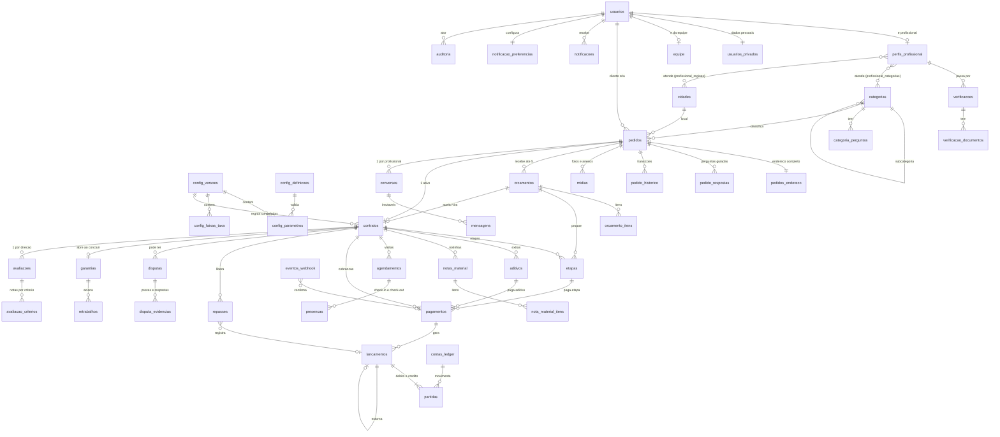

# Modelo de dados do Trato (F3.1)

> **Status: modelo aprovado pelo João (28/10/2026).** A F3.2 está aplicada no Supabase. As migrations
> F3.3 a F3.8c estão **preparadas e testadas em banco local, mas NÃO aplicadas** (cada uma pede o OK do João).
> **Custódia no caminho A (D15):** a F3.5 foi refeita (sem `chaves_pix`, `saques` nem saldo); F3.3 e F3.4 já estão aplicadas.
> As diferenças entre este desenho e o que foi escrito nas migrations estão na **seção 13**.
> Plano de aplicação, testes e riscos: `docs/seguranca-banco.md`.
> Prioridade das fontes: `regras.txt` > observações extras (D1–D12) > protótipo > escopo (PDF).
> Referências: escopo seções 3, 4, 8, 11 e 22.2; `harness/DECISOES.md`; `harness/PENDENCIAS.md`.

Em português simples: este arquivo diz **quais tabelas existem, o que cada uma guarda, quem pode ver o quê**
e **em que ordem vamos criar**. Onde o escopo não responde, está na seção 11 (dúvidas), não inventei.

---

## 1. Convenções

| Item | Regra |
|---|---|
| Banco | Postgres do Supabase, projeto "Trato", schema `public` |
| Chaves | `id uuid primary key default gen_random_uuid()`. Exceção: `usuarios.id` = `auth.users.id` |
| Dinheiro | **`bigint` em centavos**, sufixo `_centavos`, `check (>= 0)`. Nunca `numeric`/`float` |
| Percentuais | **`integer` em pontos-base (bps)**: 7,5% = `750`, 30% = `3000`. Sufixo `_bps` |
| Datas | `timestamptz` (UTC). Prazos em horas/dias úteis ficam na configuração |
| Estados | `text` + `check (... in (...))` (mais fácil de evoluir que `enum`). Confirmar na seção 11 |
| Auditoria de linha | Toda tabela mutável tem `criado_em` e `atualizado_em` (trigger) |
| Segredos | Nada de número de cartão, senha, chave ou token. Só referências do Stripe (`pi_...`, `acct_...`) |
| RLS | **Ligado em todas as tabelas, desde a criação** (sem policy = ninguém lê). As policies entram na F3.8 |
| Escritas | Proposta: o app só **lê** (via RLS); toda **escrita** passa pelo backend Python (service role). Ver N11 |
| Exclusão de conta (LGPD) | Anonimiza dados pessoais. Nunca apaga ledger, contrato, auditoria nem mensagens de pedido pago |

Tabelas **imutáveis** (sem `UPDATE`/`DELETE`, nem para o backend): `lancamentos`, `partidas`, `auditoria`,
`mensagens`, `config_parametros`/`config_faixas_taxa` de versão já publicada, `contratos` (campos congelados).
Como: `REVOKE UPDATE, DELETE` + trigger `BEFORE UPDATE OR DELETE ... RAISE EXCEPTION`.

---

## 2. Visão geral e diagrama

Grupos de tabelas e a migration que cria cada um (seção 9):

| Grupo | Tabelas | Migration |
|---|---|---|
| Identidade e catálogo | `usuarios`, `usuarios_privados`, `equipe`, `perfis_profissional`, `cidades`, `profissional_categorias`, `profissional_regioes`, `verificacoes`, `verificacao_documentos`, `categorias`, `categoria_perguntas` | F3.2 |
| Configuração versionada | `config_definicoes`, `config_versoes`, `config_parametros`, `config_faixas_taxa` | F3.2 |
| Pedido e contrato | `pedidos`, `pedidos_endereco`, `pedido_respostas`, `pedido_historico`, `midias`, `orcamentos`, `orcamento_itens`, `contratos` | F3.3 |
| Execução | `etapas`, `aditivos`, `notas_material`, `nota_material_itens`, `agendamentos`, `presencas` | F3.4 |
| Dinheiro | `pagamentos`, `eventos_webhook`, `contas_ledger`, `lancamentos`, `partidas`, `repasses` | F3.5 (caminho A, D15: sem `chaves_pix` nem `saques`) |
| Pós-serviço | `disputas`, `disputa_evidencias`, `garantias`, `retrabalhos`, `avaliacoes`, `avaliacao_criterios` | F3.6 |
| Comunicação e trilha | `conversas`, `mensagens`, `notificacoes`, `notificacao_preferencias`, `auditoria` | F3.7 |

---

## 3. Identidade, profissional, verificação e catálogo (F3.2)

### 3.1 `usuarios` — perfil público básico (1 linha por conta)
| Coluna | Tipo | Notas |
|---|---|---|
| `id` | uuid PK | = `auth.users.id` (FK, `on delete restrict`) |
| `nome` | text not null | Nome exibido |
| `foto_path` | text | Caminho no bucket privado |
| `status` | text | `ativo`, `restrito`, `bloqueado`, `anonimizado` |
| `aceite_termos_versao` | text | Versão dos termos aceitos |
| `aceite_termos_em` | timestamptz | |
| `criado_em`, `atualizado_em` | timestamptz | |

Índices: PK. Dados sensíveis ficam em `usuarios_privados` para que o RLS possa separar o que a outra parte enxerga.

### 3.2 `usuarios_privados` — dados pessoais (só o dono e a equipe autorizada)
| Coluna | Tipo | Notas |
|---|---|---|
| `usuario_id` | uuid PK, FK `usuarios` | |
| `cpf` | text not null | **unique** (um CPF por conta, escopo 11.2). Validar dígitos no backend |
| `telefone` | text | Confirmado por SMS/WhatsApp (P11) |
| `telefone_confirmado_em` | timestamptz | |
| `email_confirmado_em` | timestamptz | O e-mail em si fica em `auth.users` |
| `data_nascimento` | date | |
| `stripe_customer_id` | text unique | Cliente no Stripe (cartões tokenizados lá) |
| `stripe_account_id` | text unique | Conta do profissional (Connect) — **depende de P7** |

Índices: `unique(cpf)`, `unique(telefone)` (a confirmar), `unique(stripe_*)`.

### 3.3 `equipe` — papéis da equipe (escopo 18.5)
| Coluna | Tipo | Notas |
|---|---|---|
| `usuario_id` | uuid PK, FK `usuarios` | |
| `papel` | text | `atendente_n1`, `atendente_n2`, `mediador`, `financeiro`, `seguranca`, `cadastro`, `moderador`, `juridico`, `dpo`, `lider_suporte`, `administrador` |
| `ativo` | boolean | |
| `alcada_centavos` | bigint | Teto de estorno/decisão sem 2ª pessoa (valor definido na configuração) |
| `criado_em`, `revogado_em` | timestamptz | |

Um usuário da equipe pode ter mais de um papel? Ver N1. Se sim, a PK vira `(usuario_id, papel)`.

### 3.4 `cidades`
| Coluna | Tipo | Notas |
|---|---|---|
| `id` | uuid PK | |
| `nome`, `uf` | text | |
| `ativa` | boolean | Piloto liga só a cidade escolhida (P6: BH) |
| `centro_lat`, `centro_lng` | double precision | |

Índice: `unique(nome, uf)`.

### 3.5 `perfis_profissional`
| Coluna | Tipo | Notas |
|---|---|---|
| `usuario_id` | uuid PK, FK `usuarios` | Existir esta linha = a conta atua como profissional |
| `status` | text | `em_analise`, `aprovado`, `recusado`, `suspenso` |
| `nivel_verificacao` | text | `basico`, `verificado`, `verificado_plus` (escopo 3.1). Só `verificado`+ envia orçamento |
| `bio` | text | |
| `cnpj` | text | Opcional (o recebimento é cadastrado no parceiro de pagamento, D15) |
| `servicos_concluidos` | integer | Cache atualizado por rotina |
| `nota_publica` | numeric(3,2) | Cache. Cálculo em si **fora desta versão** (N15) |
| `reverificar_em` | timestamptz | Selfie a cada 6 meses (escopo 3.1) |
| `criado_em`, `atualizado_em` | timestamptz | |

Índices: `(status, nivel_verificacao)`.

### 3.6 `profissional_categorias` e `profissional_regioes`
| Tabela | Colunas | Chave / índice |
|---|---|---|
| `profissional_categorias` | `profissional_id`, `categoria_id`, `suspensa_em` (credencial vencida) | PK `(profissional_id, categoria_id)`; índice `(categoria_id)` |
| `profissional_regioes` | `profissional_id`, `cidade_id`, `bairro` text null | PK `(profissional_id, cidade_id, coalesce(bairro,''))`; índice `(cidade_id)` |

Granularidade da região (cidade, bairro ou raio) não está fechada: N8.

### 3.7 `verificacoes`
| Coluna | Tipo | Notas |
|---|---|---|
| `id` | uuid PK | |
| `profissional_id` | uuid FK `perfis_profissional` | |
| `nivel_solicitado` | text | `verificado`, `verificado_plus` |
| `status` | text | `enviada`, `em_analise`, `aprovada`, `recusada` |
| `analista_id` | uuid FK `equipe` | |
| `motivo_recusa` | text | |
| `fornecedor_ref` | text | Id no fornecedor de identidade — **P10** |
| `consentimento_lgpd_em` | timestamptz not null | Antecedentes exigem consentimento com finalidade (escopo 3.1) |
| `enviada_em`, `decidida_em` | timestamptz | |

Índices: `(profissional_id, enviada_em desc)`, `(status)` para a fila do painel.

### 3.8 `verificacao_documentos` — **acesso só da equipe de cadastro**
| Coluna | Tipo | Notas |
|---|---|---|
| `id` | uuid PK | |
| `verificacao_id` | uuid FK | |
| `tipo` | text | `documento_frente`, `documento_verso`, `selfie`, `antecedentes`, `comprovante_endereco`, `registro_profissional`, `curso_nr10`, `seguro`, `outro` |
| `storage_path` | text not null | Bucket **privado** dedicado; nunca URL pública |
| `sha256` | text | |
| `validade_em` | date | Credenciais com vencimento (avisar antes, suspender categoria) |
| `excluir_em` | timestamptz | Retenção limitada (LGPD). Prazo: N10 |
| `criado_em` | timestamptz | |

Índices: `(verificacao_id)`, `(validade_em)` parcial onde não nulo.

### 3.9 `categorias` e `categoria_perguntas`
| Tabela | Colunas principais | Índices |
|---|---|---|
| `categorias` | `id`, `pai_id` (FK própria, árvore), `nome`, `slug` unique, `icone`, `ordem`, `ativa`, `garantia_retrabalho_dias` integer null (null = padrão da configuração; ex. 90 em pintura) | `(pai_id, ordem)`, `unique(slug)` |
| `categoria_perguntas` | `id`, `categoria_id`, `texto`, `tipo` (`texto`, `numero`, `escolha_unica`, `multipla`, `sim_nao`), `opcoes` jsonb, `obrigatoria`, `ordem`, `ativa` | `(categoria_id, ordem)` |

Pergunta nunca é apagada, só `ativa=false`, para o pedido antigo continuar legível (o pedido também guarda o texto da pergunta, 5.3).

---

## 4. Configuração versionada (F3.2)

Tudo que é taxa, prazo e limite mora aqui, **nunca no código** (escopo 11.1 e 22.2, D2).
Regras do console (22.2) que o modelo precisa suportar: escopo (global/cidade/categoria/nível), vigência agendada,
limite mínimo/máximo, aprovação de 2 pessoas, histórico e reversão, e **congelar a versão no contrato**.

### 4.1 `config_definicoes` — catálogo dos parâmetros (o que pode ser configurado)
| Coluna | Tipo | Notas |
|---|---|---|
| `chave` | text PK | Ex.: `adiantamento_bps` |
| `descricao` | text | |
| `unidade` | text | `centavos`, `bps`, `horas`, `dias`, `dias_uteis`, `quantidade` |
| `minimo`, `maximo` | bigint | Validação por campo (regra 4 do console) |
| `escopos_permitidos` | text[] | `global`, `cidade`, `categoria`, `nivel` |
| `exige_dupla_aprovacao` | boolean | Taxa, prazos financeiros, cancelamento e textos legais (regra 2) |

### 4.2 `config_versoes`
| Coluna | Tipo | Notas |
|---|---|---|
| `id` | uuid PK | |
| `numero` | integer unique | Sequencial, vira "versão das regras" |
| `status` | text | `rascunho`, `aguardando_aprovacao`, `aprovada`, `vigente`, `substituida`, `revertida` |
| `vigente_desde` | timestamptz | Vigência agendada |
| `criada_por`, `aprovada_por` | uuid FK `equipe` | `check (criada_por <> aprovada_por)` |
| `motivo` | text not null | |
| `revertida_de` | uuid FK `config_versoes` | Reversão cria **nova versão** copiando a antiga; não edita histórico |

Índice único parcial: só **uma** versão `vigente` por vez (`unique ... where status='vigente'`).
Depois de `aprovada`, a versão e suas linhas ficam **imutáveis**.

### 4.3 `config_parametros`
| Coluna | Tipo | Notas |
|---|---|---|
| `id` | uuid PK | |
| `versao_id` | uuid FK `config_versoes` | |
| `chave` | text FK `config_definicoes` | |
| `valor` | bigint not null | Na unidade da definição |
| `escopo_tipo` | text | `global`, `cidade`, `categoria`, `nivel` |
| `escopo_id` | uuid null | cidade/categoria; nível usa `escopo_texto` |
| `escopo_texto` | text null | |

Índice: `unique(versao_id, chave, escopo_tipo, coalesce(escopo_id, zero_uuid), coalesce(escopo_texto,''))`.
Resolução: escopo mais específico vence (categoria/cidade/nível > global). O backend resolve e **copia o resultado no contrato**.

Parâmetros previstos. "Valor inicial" só aparece quando vem de decisão ou do escopo; **onde está "—" o João ainda decide**:

| Chave | Unidade | Valor inicial | Origem |
|---|---|---|---|
| `adiantamento_bps` | bps | 3000 (30%) | D5 |
| `taxa_minima_centavos` ou `taxa_minima_bps` | — | — | D2, **P2 / N2** |
| `prazo_liberacao_dias` | dias | 7 | D6 (**P1**: protótipo diz 48 h) |
| `prazo_confirmacao_cliente_horas` | horas | — | Escopo 4: 48 h (72 h > R$ 1.500). **P1** |
| `limite_valor_72h_centavos` | centavos | 150000 | Escopo 4 (R$ 1.500). Depende de P1 |
| `janela_chargeback_dias` | dias | 7 | D3 |
| `prazo_congelar_disputa_horas` | horas | 72 | Escopo 3.5 (jurídico altera). Relação com D3: **P1/N17** |
| `prazo_resposta_disputa_horas` | horas | 48 | Escopo 3.5 |
| `prazo_decisao_disputa_dias_uteis` | dias_uteis | 5 | Escopo 3.5 |
| `prazo_retrabalho_atendimento_dias` | dias | 7 | Escopo 3.6 |
| `garantia_retrabalho_dias_padrao` | dias | 30 | Escopo 3.6 (por categoria em `categorias`) |
| `limite_orcamentos_por_pedido` | quantidade | 5 | Escopo 4 |
| `validade_pedido_horas` / `validade_pedido_urgente_horas` | horas | 48 / 2 | Escopo 5.3 |
| `prazo_pagamento_pendente_horas` | horas | 2 | Escopo 4 ("sugestão") |
| `valor_minimo_servico_centavos` | centavos | 3000 | Escopo 8.2 / 22.2 |
| `limite_transacao_por_nivel_centavos` | centavos | — | Escopo 8.2, "por nível" sem valores |
| `prazo_cancelamento_reembolso_integral_horas` | horas | 24 | Escopo 3.2 |
| `parcelas_max_cartao` | quantidade | 12 | Escopo 8.2 (conflito com P3) |
| `aprovacao_aditivo_prazo_horas` | horas | — | Escopo não define (N14) |
| `endereco_liberado_horas_antes` | horas | — | Escopo 3.7 diz "2 horas antes" (N12) |

### 4.4 `config_faixas_taxa` — taxa progressiva (D2)
| Coluna | Tipo | Notas |
|---|---|---|
| `id` | uuid PK | |
| `versao_id` | uuid FK `config_versoes` | Faixas pertencem a uma versão |
| `de_centavos` | bigint not null | Início da faixa (inclusive) |
| `ate_centavos` | bigint null | Fim (exclusive). `null` = sem teto |
| `taxa_bps` | integer not null | `check (taxa_bps between 0 and 10000)` |
| `escopo_tipo`, `escopo_id` | | Mesmo modelo do 4.3 (taxa pode ter exceção por recorrência, escopo 22.2) |

Restrições: faixas da mesma versão/escopo **sem sobreposição e sem buraco** (constraint `EXCLUDE` com `int8range`).
**Quais faixas e percentuais e se 7,5% é a faixa mais alta ou mais baixa: P2.** Este modelo não assume nada;
a regra de cálculo (cumulativa por faixa ou faixa única pelo valor total) também é do backend e aguarda P2.

### 4.5 Versão congelada no contrato
Ao aceitar o orçamento, `contratos` grava `config_versao_id` **e** `regras_aplicadas jsonb` (os valores já resolvidos
por cidade/categoria/nível, mais a taxa calculada). Mudança futura de configuração só vale para pedidos novos
(regra 1 do console). Nunca recalcular contrato antigo a partir da configuração atual.

---

## 5. Pedido, orçamento e contrato (F3.3)

Estados do pedido (escopo 4, 10 estados): `aberto`, `orcamento_aceito`, `pago_retido`, `agendado`,
`em_andamento`, `em_confirmacao`, `concluido`, `cancelado`, `em_disputa`, `retrabalho`.
Quem faz cada transição e com qual prova é da máquina de estados do backend (F4.1); o banco só guarda o estado e o histórico.

### 5.1 `pedidos`
| Coluna | Tipo | Notas |
|---|---|---|
| `id` | uuid PK | |
| `cliente_id` | uuid FK `usuarios` | |
| `categoria_id` | uuid FK `categorias` | |
| `cidade_id` | uuid FK `cidades` | |
| `bairro` | text | Aproximado. **O endereço completo NÃO fica aqui** |
| `local_aprox_lat`, `local_aprox_lng` | double precision | Arredondados (~500 m) para o mapa/filtro do profissional |
| `titulo`, `descricao` | text | |
| `prazo_desejado` | date / text | |
| `faixa_preco_min_centavos`, `faixa_preco_max_centavos` | bigint null | Faixa opcional do cliente |
| `urgente` | boolean | |
| `status` | text | Os 10 estados acima |
| `orcamentos_ate` | timestamptz | Fim do prazo para receber orçamentos |
| `expira_em` | timestamptz | |
| `criado_em`, `atualizado_em` | timestamptz | |

Índices: `(cliente_id, criado_em desc)`; **parcial** `(categoria_id, cidade_id, criado_em desc) where status='aberto'`
(é o que o profissional lista); `(status)`.

### 5.2 `pedidos_endereco` — endereço completo (liberado só após contratação)
| Coluna | Tipo | Notas |
|---|---|---|
| `pedido_id` | uuid PK, FK `pedidos` | |
| `cep`, `logradouro`, `numero`, `complemento`, `bairro`, `referencia` | text | |
| `lat`, `lng` | double precision | Exatos |
| `liberado_em` | timestamptz null | Preenchido quando o contrato é aceito/pago (N12) |

Separar em tabela própria é a forma de o RLS esconder o endereço: RLS filtra **linhas**, não colunas.

### 5.3 `pedido_respostas` — perguntas guiadas
| Coluna | Tipo | Notas |
|---|---|---|
| `pedido_id`, `pergunta_id` | uuid | PK composta |
| `pergunta_texto` | text | Cópia do texto no momento (a pergunta pode mudar depois) |
| `resposta` | jsonb | |

### 5.4 `pedido_historico` — toda transição de estado
| Coluna | Tipo | Notas |
|---|---|---|
| `id` | bigserial PK | |
| `pedido_id` | uuid FK | |
| `de_status`, `para_status` | text | |
| `ator_id` | uuid null | null = rotina automática |
| `motivo` | text | |
| `prova` | jsonb | Ex.: `{presenca_id, codigo_validado, pagamento_id}` |
| `ocorrida_em` | timestamptz | |

Índice: `(pedido_id, ocorrida_em)`. Append-only (trigger). A mesma ação também vai para `auditoria`.

### 5.5 `midias` — fotos e anexos ligados a um pedido
| Coluna | Tipo | Notas |
|---|---|---|
| `id` | uuid PK | |
| `pedido_id` | uuid FK not null | Toda mídia pertence a um pedido (RLS fica uma regra só) |
| `enviada_por` | uuid FK `usuarios` | |
| `finalidade` | text | `pedido`, `antes`, `durante`, `depois`, `checkin`, `checkout`, `nota_material`, `aditivo`, `disputa`, `retrabalho`, `chat` |
| `storage_path` | text not null | Bucket privado |
| `mime`, `tamanho_bytes` | text, bigint | |
| `sha256` | text | Detecta foto reaproveitada (antifraude, escopo 3.8) |
| `capturada_em` | timestamptz | Data/hora gravadas (escopo 3.3) |
| `lat`, `lng` | double precision | |
| `criado_em` | timestamptz | |

Índices: `(pedido_id, finalidade)`, `(sha256)`. Imutável após o envio (prova).

### 5.6 `orcamentos`
| Coluna | Tipo | Notas |
|---|---|---|
| `id` | uuid PK | |
| `pedido_id` | uuid FK | |
| `profissional_id` | uuid FK `perfis_profissional` | |
| `versao` | integer | Contraproposta/ajuste gera nova versão; antigas são preservadas |
| `status` | text | `rascunho`, `enviado`, `aceito`, `recusado`, `substituido`, `expirado`, `retirado` |
| `valor_total_centavos` | bigint | Soma dos itens (conferida por trigger/backend) |
| `prazo_execucao_dias` | integer | |
| `validade_ate` | timestamptz | |
| `garantia_dias` | integer | Garantia ofertada |
| `fora_do_escopo` | text | Entra no contrato (escopo 3.3) |
| `sinal_material_centavos` | bigint null | Sinal de material (escopo 3.2) — **ligado a P4** |
| `observacoes` | text | |
| `criado_em`, `atualizado_em`, `enviado_em` | timestamptz | |

Índices: `unique(pedido_id, profissional_id, versao)`; `(pedido_id, status)`; `(profissional_id, status)`.
Limite de 5 orçamentos enviados por pedido é validado no backend (valor vem da configuração).
Cliente só vê orçamentos com `status <> 'rascunho'`.

### 5.7 `orcamento_itens`
| Coluna | Tipo | Notas |
|---|---|---|
| `id` | uuid PK | |
| `orcamento_id` | uuid FK | |
| `tipo` | text | `deslocamento`, `horas`, `material`, `outro` (escopo 5.3 e calculadora) |
| `descricao` | text | |
| `quantidade` | numeric(10,2) | |
| `valor_unitario_centavos` | bigint | |
| `total_centavos` | bigint | `quantidade × unitário`, arredondamento definido no backend |
| `ordem` | integer | |

O item `deslocamento` é o que fica com o profissional num cancelamento tardio (escopo 3.2).

### 5.8 `contratos` — gerado no aceite (escopo congelado)
| Coluna | Tipo | Notas |
|---|---|---|
| `id` | uuid PK | |
| `pedido_id` | uuid FK **unique** | Um contrato por pedido |
| `orcamento_id` | uuid FK | O orçamento aceito |
| `cliente_id`, `profissional_id` | uuid FK | |
| `status` | text | `aguardando_pagamento`, `ativo`, `concluido`, `cancelado`, `em_disputa` |
| `escopo_texto` | text | Descrição congelada |
| `fora_do_escopo` | text | |
| `itens` | jsonb | Cópia dos itens do orçamento |
| `prazo_execucao_dias`, `garantia_dias` | integer | |
| `valor_total_centavos` | bigint | |
| `taxa_bps_aplicada` | integer | Resultado da tabela progressiva no aceite |
| `taxa_trato_centavos` | bigint | |
| `liquido_profissional_centavos` | bigint | `total − taxa` (**P3**: se o cliente paga acréscimo, a conta muda) |
| `adiantamento_centavos` | bigint | 30% (D5) |
| `custo_stripe_estimado_centavos` | bigint | D4: Pix e cartão; mostra a sobra do Trato |
| `config_versao_id` | uuid FK `config_versoes` | **Versão das regras congelada** |
| `regras_aplicadas` | jsonb | Valores resolvidos (prazos, cancelamento, garantia) |
| `hash_documento` | text | Hash do termo aceito |
| `aceito_em` | timestamptz | |
| `aceite_ip`, `aceite_dispositivo` | text | Prova do aceite |
| `criado_em` | timestamptz | |

Índices: `unique(pedido_id)`, `(cliente_id)`, `(profissional_id, status)`.
Campos congelados (valores, escopo, config) são imutáveis por trigger; só `status` muda.
Aditivo e etapa mudam o total por registros próprios (6.1, 6.2), não editando o contrato.

---

## 6. Execução: etapas, aditivos, notas, agendamento e prova (F3.4)

### 6.1 `etapas`
| Coluna | Tipo | Notas |
|---|---|---|
| `id` | uuid PK | |
| `orcamento_id` | uuid FK | Nasce como proposta do orçamento |
| `contrato_id` | uuid FK null | Preenchido no aceite; descrição/valor congelam |
| `ordem` | integer | |
| `descricao` | text | |
| `valor_centavos` | bigint | |
| `status` | text | `prevista`, `em_execucao`, `aguardando_aprovacao`, `aprovada`, `paga`, `liberada` |
| `prova_midia_id` | uuid FK `midias` | Prova da etapa |
| `aprovada_em` | timestamptz | |

Índice: `unique(orcamento_id, ordem)`. "Cada etapa é paga e liberada separadamente" (escopo 3.2).
Como etapas convivem com os 30% adiantados: N13.

### 6.2 `aditivos`
| Coluna | Tipo | Notas |
|---|---|---|
| `id` | uuid PK | |
| `contrato_id` | uuid FK | |
| `criado_por` | uuid FK | Profissional |
| `motivo` | text not null | |
| `valor_centavos` | bigint not null | |
| `taxa_bps_aplicada`, `taxa_trato_centavos` | integer, bigint | Regra de faixa para aditivo: **N3** |
| `status` | text | `pendente`, `aprovado`, `recusado`, `expirado`, `cancelado` |
| `decidido_por`, `decidido_em` | uuid, timestamptz | Só vale com aprovação do cliente no app (D9) |
| `criado_em` | timestamptz | |

Fotos do aditivo: `midias` com `finalidade='aditivo'`. Pagamento próprio em `pagamentos.aditivo_id`.
Índice: `(contrato_id, status)`. Aprovado vira imutável.

### 6.3 `notas_material` e `nota_material_itens` (D8)
| Tabela | Colunas | Notas |
|---|---|---|
| `notas_material` | `id`, `contrato_id`, `aditivo_id` null, `etapa_id` null, `enviada_por`, `midia_id` (foto da notinha), `total_centavos`, `status` (`enviada`, `vista`, `contestada`), `enviada_em`, `vista_em` | Índice `(contrato_id)` |
| `nota_material_itens` | `id`, `nota_id`, `descricao`, `quantidade`, `valor_unitario_centavos`, `total_centavos`, `ordem` | Cliente vê quanto custou cada material |

Se a nota é pré-requisito para liberar o sinal de material: P4. Se o valor da nota entra na base da taxa: N4.

### 6.4 `agendamentos`
| Coluna | Tipo | Notas |
|---|---|---|
| `id` | uuid PK | |
| `contrato_id` | uuid FK | |
| `etapa_id` | uuid null | Visita pode ser de uma etapa |
| `data` | date | |
| `janela_inicio`, `janela_fim` | timestamptz | |
| `status` | text | `proposto`, `confirmado`, `remarcado`, `realizado`, `nao_compareceu`, `cancelado` |
| `remarcado_de` | uuid FK própria | Remarcação exige aceite da outra parte |
| `codigo_inicio_hash` | text | Código de 4 dígitos do cliente, **guardado como hash** |
| `codigo_conclusao_hash` | text | |
| `codigo_expira_em` | timestamptz | |
| `endereco_liberado_em` | timestamptz | |

Índices: `(contrato_id, data)`, `(status, janela_inicio)` para a agenda do profissional.

### 6.5 `presencas` — check-in e check-out
| Coluna | Tipo | Notas |
|---|---|---|
| `id` | uuid PK | |
| `agendamento_id` | uuid FK | |
| `tipo` | text | `check_in`, `check_out` |
| `registrada_por` | uuid FK | |
| `lat`, `lng`, `precisao_m` | double precision | Geolocalização |
| `distancia_do_endereco_m` | integer | Calculada no backend (antifraude: fora do raio) |
| `foto_midia_id` | uuid FK `midias` | |
| `codigo_validado` | boolean | Início: código do cliente. Fim: código de conclusão |
| `registrada_em` | timestamptz | Hora do servidor, não do aparelho |
| `offline_capturada_em` | timestamptz null | Modo offline parcial (V1) |

Índice: `unique(agendamento_id, tipo)`. Imutável. Fotos antes/durante/depois ficam em `midias`.

---

## 7. Dinheiro: pagamento, ledger espelho e ordem de liberação (F3.5, caminho A)

> **D15 (29/10/2026):** o parceiro de pagamento custodia e liquida; o Trato não guarda saldo próprio nem faz saque. O ledger só espelha. A seção 7.5 (`chaves_pix`, `saques`) e a view de saldo do desenho original **foram retiradas**.

> Nenhuma tabela desta seção é escrita pelo app. Só o backend, com chave de idempotência.

### 7.1 `pagamentos` (cobranças ao cliente)
| Coluna | Tipo | Notas |
|---|---|---|
| `id` | uuid PK | |
| `contrato_id` | uuid FK | |
| `pagador_id` | uuid FK `usuarios` | Cartão/Pix só no CPF do próprio cliente (escopo 3.1) |
| `tipo` | text | `adiantamento`, `saldo`, `etapa`, `aditivo` |
| `etapa_id`, `aditivo_id` | uuid null | Conforme o tipo |
| `meio` | text | `pix`, `cartao_credito`, `cartao_debito` |
| `parcelas` | smallint | 1 a 12 |
| `valor_centavos` | bigint | Valor do serviço cobrado |
| `acrescimo_cliente_centavos` | bigint default 0 | Só se **P3** escolher opção C |
| `custo_stripe_estimado_centavos`, `custo_stripe_real_centavos` | bigint | D4: o real vem do Stripe após a captura |
| `status` | text | `pendente`, `confirmado`, `falhou`, `expirado`, `reembolsado_parcial`, `reembolsado`, `contestado` |
| `stripe_payment_intent_id` | text unique | Referência do parceiro |
| `chave_idempotencia` | text unique not null | |
| `confirmado_em` | timestamptz | |
| `janela_chargeback_ate` | timestamptz | `confirmado_em + 7 dias` (D3) |
| `criado_em`, `atualizado_em` | timestamptz | |

Índices: `(contrato_id, tipo)`, `(status)`, `unique(stripe_payment_intent_id)`, `unique(chave_idempotencia)`.
Sem número de cartão, sem CVV, sem token além do id do Stripe.

### 7.2 `eventos_webhook` — webhooks assinados e sem repetição
| Coluna | Tipo | Notas |
|---|---|---|
| `id` | uuid PK | |
| `provedor` | text | `stripe` |
| `evento_id` | text | Id do evento no provedor |
| `tipo` | text | |
| `assinatura_valida` | boolean | Evento com assinatura inválida é guardado mas **não processado** |
| `payload` | jsonb | Sem dados de cartão |
| `recebido_em`, `processado_em` | timestamptz | |
| `erro` | text | |

Índice: `unique(provedor, evento_id)` — reenvio do mesmo evento não duplica lançamento (F4.5).

### 7.3 Ledger imutável de partidas dobradas

Três tabelas. **Não há saldo no banco** (nem coluna, nem view): a Carteira do app é extrato; totais para conciliação saem das partidas, no backend.

#### `contas_ledger`
| Coluna | Tipo | Notas |
|---|---|---|
| `id` | uuid PK | |
| `codigo` | text unique | Ver contas abaixo |
| `natureza` | text | `ativo`, `passivo`, `receita`, `despesa` |
| `usuario_id` | uuid null | Contas por usuário (carteira do profissional) |
| `moeda` | char(3) | `BRL` |

Contas de sistema propostas: `caixa_parceiro` (dinheiro no Stripe), `retido_servico` (dinheiro do cliente retido),
`receita_trato` (taxa), `despesa_stripe` (custo de processamento). Conta por usuário: `a_pagar_profissional`
(líquido liberado, ainda não sacado). **Fundo de garantia e reserva do profissional não têm conta** (P8, N6).

#### `lancamentos` (cabeçalho de cada evento financeiro)
| Coluna | Tipo | Notas |
|---|---|---|
| `id` | uuid PK | |
| `contrato_id` | uuid FK | Partidas dobradas **por serviço** (obrigatório) |
| `pagamento_id`, `repasse_id`, `disputa_id`, `evento_webhook_id` | uuid null | Origem. `evento_webhook_id` = evento do parceiro que este lançamento espelha |
| `tipo` | text | `cobranca`, `retencao`, `taxa`, `custo_stripe`, `repasse`, `reembolso`, `estorno` |
| `estorna_id` | uuid FK `lancamentos` null | Só estorno corrige; aponta o lançamento original |
| `chave_idempotencia` | text **unique** not null | |
| `descricao` | text | |
| `ocorrido_em` | timestamptz | |
| `criado_por` | uuid null | null = sistema |

#### `partidas`
| Coluna | Tipo | Notas |
|---|---|---|
| `id` | bigserial PK | |
| `lancamento_id` | uuid FK | |
| `conta_id` | uuid FK `contas_ledger` | |
| `sentido` | text | `debito` ou `credito` |
| `valor_centavos` | bigint | `check (> 0)` |

**Garantias no banco:**
1. `CONSTRAINT TRIGGER ... DEFERRABLE INITIALLY DEFERRED`: ao fechar a transação, `Σ débitos = Σ créditos` por lançamento, senão aborta.
2. `REVOKE UPDATE, DELETE` e trigger que levanta exceção em `lancamentos` e `partidas` (inclusive para `service_role`).
3. `unique(estorna_id)`: um lançamento só é estornado uma vez. Estorno = novo lançamento com partidas invertidas.
4. Índices: `(lancamento_id)`, `(conta_id)`, `(contrato_id)` em `lancamentos`.

Exemplo do desenho (valores ilustrativos; o cálculo real depende de P1–P4):

| Evento | Débito | Crédito |
|---|---|---|
| Cobrança confirmada (R$ 100) | `caixa_parceiro` 100 | `retido_servico` 100 |
| Custo Stripe (R$ 2) | `despesa_stripe` 2 | `caixa_parceiro` 2 |
| Liberação: taxa | `retido_servico` T | `receita_trato` T |
| Liberação: líquido | `retido_servico` L | `a_pagar_profissional` L |
| Repasse liquidado pelo parceiro ao profissional (espelho do evento; **o Trato não faz saque**, D15) | `a_pagar_profissional` L | `caixa_parceiro` L |
| Estorno de qualquer um | partidas invertidas do original | |

Carteira do profissional (retido / a liberar / liberado): derivada de `retido_servico` por contrato,
`repasses` agendados e `a_pagar_profissional`. Nada guardado em coluna.

### 7.4 `repasses` — ordem de liberação ao parceiro (não é saldo nem saque)
| Coluna | Tipo | Notas |
|---|---|---|
| `id` | uuid PK | |
| `contrato_id` | uuid FK | |
| `etapa_id` | uuid null | Repasse por etapa |
| `profissional_id` | uuid FK | |
| `valor_bruto_centavos`, `taxa_centavos`, `valor_liquido_centavos` | bigint | |
| `gatilho` | text | `confirmacao_cliente`, `prazo`, `etapa_aprovada`, `decisao_disputa`, `sinal_material` |
| `status` | text | `agendado`, `congelado`, `liberado`, `estornado` |
| `liberar_em` | timestamptz | Prazo (7 dias, D6; **P1**) |
| `provedor_transferencia_id` | text unique null | Id da transferência no parceiro (espelho) |
| `congelado_por_disputa_id` | uuid null | D7: disputa congela o valor |
| `lancamento_id` | uuid FK null | Lançamento que efetivou |
| `chave_idempotencia` | text unique | |
| `criado_em`, `liberado_em` | timestamptz | |

Índice parcial: `(liberar_em) where status='agendado'` (rotina de liberação F4.9).

---

## 8. Disputa, garantia, avaliação, chat, notificação e auditoria (F3.6 e F3.7)

### 8.1 `disputas` (F3.6)
| Coluna | Tipo | Notas |
|---|---|---|
| `id` | uuid PK | |
| `contrato_id`, `pedido_id` | uuid FK | |
| `aberta_por` | uuid FK `usuarios` | |
| `motivo` | text | `abandono`, `mal_feito`, `dano`, `cobranca_extra`, `nao_compareceu`, `diferente_combinado` (escopo 3.5) |
| `descricao` | text | |
| `status` | text | `aberta`, `aguardando_profissional`, `em_analise`, `acordo`, `decidida`, `cancelada` |
| `valor_congelado_centavos` | bigint | D7 |
| `resposta_ate` | timestamptz | +48 h |
| `decisao_ate` | timestamptz | +5 dias úteis |
| `decisao` | text null | `liberar_tudo`, `reembolso_total`, `reembolso_parcial`, `nova_visita` |
| `valor_reembolso_centavos` | bigint null | Parcial: valor ou percentual (guardar o valor; percentual é auditado em `justificativa`) |
| `procedente` | boolean null | Alimenta reputação |
| `relato_ma_fe` | boolean null | Relato falso marca a conta |
| `decidida_por`, `aprovada_por` | uuid FK `equipe` | Acima da alçada exige 2ª pessoa (18.5) |
| `justificativa` | text | |
| `aberta_em`, `decidida_em` | timestamptz | |

Índices: `(contrato_id)`, parcial `(decisao_ate) where status in ('aberta','aguardando_profissional','em_analise')`.
Uma disputa aberta por contrato (`unique(contrato_id) where status` ativo). Como D3 (7 dias) e o prazo de 72 h do escopo
convivem: N17.

### 8.2 `disputa_evidencias` (provas e respostas)
| Coluna | Tipo | Notas |
|---|---|---|
| `id` | uuid PK | |
| `disputa_id` | uuid FK | |
| `autor_id` | uuid FK | Cliente, profissional ou equipe |
| `tipo` | text | `relato`, `resposta`, `proposta_retorno`, `foto`, `documento`, `nota_interna` |
| `texto` | text | |
| `midia_id` | uuid FK `midias` null | |
| `visivel_as_partes` | boolean | `nota_interna` = false |
| `criado_em` | timestamptz | |

Índice: `(disputa_id, criado_em)`. Append-only. O analista também enxerga contrato, fotos, chat, check-in/out do pedido.

### 8.3 `garantias` e `retrabalhos` (F3.6)
| Tabela | Colunas | Chave / índice |
|---|---|---|
| `garantias` | `id`, `contrato_id` unique, `inicio_em` (conclusão), `fim_em`, `dias` (da categoria ou padrão, congelado), `status` (`ativa`, `expirada`, `encerrada`) | `unique(contrato_id)`, parcial `(fim_em) where status='ativa'` |
| `retrabalhos` | `id`, `garantia_id`, `aberto_por`, `descricao`, `status` (`aberto`, `aceito`, `em_execucao`, `resolvido`, `nao_atendido`, `reatribuido`), `atender_ate` (+7 dias), `atendido_em`, `outro_profissional_id` null, `custo_centavos` null, `aberto_em` | `(garantia_id)`, parcial `(atender_ate) where status in ('aberto','aceito')` |

Quem paga o custo quando outro profissional corrige ("valor retido ou reserva do profissional", escopo 3.6) e
"alimenta o fundo": depende de P8 e N6. O modelo só registra `custo_centavos`.

### 8.4 `avaliacoes` e `avaliacao_criterios` (F3.6)
| Tabela | Colunas | Chave / índice |
|---|---|---|
| `avaliacoes` | `id`, `contrato_id`, `direcao` (`cliente_para_profissional`, `profissional_para_cliente`), `avaliador_id`, `avaliado_id`, `nota_geral` smallint `check 1..5`, `comentario`, `etiquetas` text[], `resposta` (do avaliado), `status` (`publicada`, `descartada`, `em_revisao`), `criada_em` | `unique(contrato_id, direcao)`; `(avaliado_id, criada_em desc)` |
| `avaliacao_criterios` | `avaliacao_id`, `criterio`, `nota` 1..5 | PK `(avaliacao_id, criterio)`. Critérios do cliente: pontualidade, qualidade, limpeza, comunicação, preço justo. Do profissional: respeito, clareza, acesso, presença, pagamento no prazo |

Só avalia quem contratou **e pagou** (check no backend contra `contratos.status` e `pagamentos`). Fórmula de nota pública, score e
níveis ficam **fora** (N15). Nota do cliente não é pública (RLS).

### 8.5 `conversas` e `mensagens` (F3.7)
| Tabela | Colunas | Chave / índice |
|---|---|---|
| `conversas` | `id`, `pedido_id`, `cliente_id`, `profissional_id`, `criada_em`, `encerrada_em` | `unique(pedido_id, profissional_id)` — um chat por pedido e profissional |
| `mensagens` | `id` bigserial, `conversa_id`, `autor_id`, `corpo` (**original**, evidência), `corpo_exibido` (mascarado antes da contratação), `mascarada` boolean, `midia_id` null, `enviada_em`, `lida_em` | `(conversa_id, id)` |

**Mensagem não é editável nem removível** (escopo 11.2): `REVOKE UPDATE, DELETE` + trigger.
Só `lida_em` muda (mova para tabela `mensagens_leitura` se quisermos imutabilidade total — N9).
Quem lê o `corpo` original: N9.

### 8.6 `notificacoes` e `notificacao_preferencias` (F3.7)
| Tabela | Colunas | Chave / índice |
|---|---|---|
| `notificacoes` | `id`, `usuario_id`, `tipo`, `canal` (`push`, `sms`, `whatsapp`, `email`, `app`), `titulo`, `corpo`, `dados` jsonb (deep link), `criada_em`, `enviada_em`, `lida_em` | `(usuario_id, criada_em desc)`, parcial `(usuario_id) where lida_em is null` |
| `notificacao_preferencias` | `usuario_id` PK, `preferencias` jsonb (por tipo e canal), `atualizada_em` | PK |

Provedor de SMS/WhatsApp: P11. Envio real exige OK do João.

### 8.7 `auditoria` — imutável (F3.7)
| Coluna | Tipo | Notas |
|---|---|---|
| `id` | bigserial PK | |
| `ocorrida_em` | timestamptz | |
| `ator_id` | uuid null | null = sistema/rotina |
| `ator_tipo` | text | `cliente`, `profissional`, `equipe`, `sistema` |
| `acao` | text | `contrato.aceito`, `checkin.registrado`, `repasse.liberado`, `disputa.decidida`, `config.publicada`, `dado_pessoal.revelado`... |
| `entidade`, `entidade_id` | text, uuid | |
| `antes`, `depois` | jsonb | Sem dados sensíveis em claro |
| `motivo` | text | Obrigatório em ação financeira, bloqueio e revelação de dado pessoal (18.5, 22.4) |
| `ip`, `dispositivo`, `request_id` | text | |
| `hash_anterior`, `hash` | text | **Proposta:** cadeia de hash para provar que não houve remoção (N16) |

Índices: `(entidade, entidade_id, ocorrida_em)`, `(ator_id, ocorrida_em)`, `(acao, ocorrida_em)`.
Escrita só por função `registrar_auditoria()` (`SECURITY DEFINER`); `REVOKE UPDATE, DELETE, TRUNCATE` para todos, inclusive administrador
(o escopo diz que ninguém apaga auditoria, nem o DPO).

---

## 9. Ordem sugerida das migrations

Cada uma precisa do **OK do João** antes de aplicar (regra do CLAUDE.md). Cada migration cria as tabelas, índices, triggers de
imutabilidade **e já liga `ENABLE ROW LEVEL SECURITY`** (sem policy = fechado). As policies entram todas na F3.8.

| Migration | Conteúdo | Depende de |
|---|---|---|
| **F3.2** | Função/trigger `atualizado_em`; `usuarios`, `usuarios_privados`, `equipe`, `cidades`, `categorias`, `categoria_perguntas`, `perfis_profissional`, `profissional_categorias`, `profissional_regioes`, `verificacoes`, `verificacao_documentos`; `config_definicoes`, `config_versoes`, `config_parametros`, `config_faixas_taxa` + seed das definições (sem valores de taxa até **P2**) | — |
| **F3.3** | `pedidos`, `pedidos_endereco`, `pedido_respostas`, `pedido_historico`, `midias`, `orcamentos`, `orcamento_itens`, `contratos` (com `config_versao_id`) | F3.2 |
| **F3.4** | `etapas`, `aditivos`, `notas_material`, `nota_material_itens`, `agendamentos`, `presencas` | F3.3 |
| **F3.5** | `pagamentos`, `eventos_webhook`, `contas_ledger` (+ contas de sistema), `lancamentos`, `partidas` (constraint trigger de equilíbrio + imutabilidade), `repasses` (caminho A, D15) | F3.3, F3.4 |
| **F3.6** | `disputas`, `disputa_evidencias`, `garantias`, `retrabalhos`, `avaliacoes`, `avaliacao_criterios`; FK `repasses.congelado_por_disputa_id` | F3.5 |
| **F3.7** | `conversas`, `mensagens`, `notificacoes`, `notificacao_preferencias`, `auditoria` + `registrar_auditoria()` | F3.3 |
| **F3.8** | Funções auxiliares (`eh_equipe`, `pode_ver_pedido`, `eh_parte_do_contrato`) e **todas as policies** da seção 10; testes de acesso com dois usuários | F3.2–F3.7 |

F3.9 (advisors do Supabase) roda depois da F3.8. Dois cuidados:
- Buckets do Storage (privados) e suas policies entram na F3.8; a F3.2 só cria as tabelas que guardam os caminhos.
- Seed da taxa e da cidade do piloto **só depois** de P2 e P6. O seed é `INSERT` e também pede OK.

---

## 10. RLS — quem vê o quê

Princípios: negar por padrão; `auth.uid()` identifica o usuário; funções auxiliares `SECURITY DEFINER` com `search_path` fixo
(evitam recursão entre policies); **o app só tem `SELECT`** (e Realtime), e as escritas vão pelo backend com `service_role`
(N11). Abaixo, "parte" = cliente ou profissional do contrato; "equipe(x)" = linha ativa em `equipe` com papel x.

### 10.1 Regras que o escopo exige (resumo)
| Regra | Como o modelo cumpre |
|---|---|
| Cliente só vê os próprios pedidos | `pedidos.cliente_id = auth.uid()` |
| Profissional só vê pedidos **abertos da sua categoria e região** e os que **contratou** | Policy 1: `status='aberto'` e categoria em `profissional_categorias` (não suspensa) e cidade em `profissional_regioes` e perfil `aprovado`. Policy 2: é `profissional_id` de um contrato do pedido |
| Endereço completo só após contratação | Tabela `pedidos_endereco` à parte: só o cliente dono e o profissional do **contrato ativo** com `liberado_em is not null`. Antes disso o profissional só enxerga `bairro` e coordenada aproximada em `pedidos` |
| Documentos de verificação só para a equipe | `verificacao_documentos` e o bucket: só `equipe(cadastro)`; nem o próprio profissional lê de volta (só envia, via backend) |
| Telefone não exposto | `usuarios_privados` só do dono; a outra parte vê `usuarios` (nome/foto) e o chat intermediado |

### 10.2 Policy por tabela
| Tabela | Cliente | Profissional | Equipe | Observação |
|---|---|---|---|---|
| `usuarios` | Própria linha; nome/foto da contraparte de um contrato | Própria; nome/foto do cliente do contrato | N1/N2 (suporte), todos os papéis leem nome/status | Nome e foto, nada mais |
| `usuarios_privados` | Só a própria | Só a própria | `cadastro`, `seguranca`, `dpo`; cada leitura gera `auditoria` com motivo | Mascarado por padrão no painel |
| `equipe` | — | — | Só `administrador` e a própria linha | |
| `cidades`, `categorias`, `categoria_perguntas` | Leitura (ativas) | Leitura | Leitura/escrita via backend | Públicas para autenticados |
| `perfis_profissional` | Leitura dos campos públicos de perfis `aprovado` (via view `perfis_publicos`) | Próprio perfil completo | `cadastro`, `suporte`, `mediador` | A tabela base não é exposta; a view esconde dados internos |
| `profissional_categorias`, `profissional_regioes` | Via view pública | Próprias | `cadastro` | |
| `verificacoes` | — | Própria (status e motivo da recusa) | `cadastro` | |
| `verificacao_documentos` | — | — | **Só `cadastro`** | Ver 10.1 |
| `config_*` | — | — | Leitura: financeiro, jurídico, produto, administrador. Escrita: backend, com dupla aprovação | O app recebe valores resolvidos pela API, não lê a tabela |
| `pedidos` | Próprios | Abertos da categoria/região; contratados por ele | N2, mediador, financeiro, segurança (leitura) | Ver 10.1 |
| `pedidos_endereco` | Próprio | Só contrato ativo e `liberado_em` preenchido | `seguranca` (durante o atendimento), mediador (em disputa) | Mascarado no painel |
| `pedido_respostas`, `midias` (finalidade pedido) | Próprios | Mesmo critério de visibilidade do pedido | Como `pedidos` | `midias`: chat/disputa seguem as policies de `conversas`/`disputas` |
| `pedido_historico` | Dos próprios pedidos | Dos pedidos visíveis a ele | Leitura | Só leitura |
| `orcamentos`, `orcamento_itens`, `etapas` (do orçamento) | Dos próprios pedidos, exceto `rascunho` | Os próprios | Leitura para mediador, financeiro | Um profissional não vê o orçamento de outro |
| `contratos`, `agendamentos`, `presencas`, `etapas` | Parte | Parte | Mediador, financeiro, segurança (leitura) | |
| `aditivos`, `notas_material`, `nota_material_itens` | Parte | Parte (rascunho só do autor) | Mediador, financeiro | |
| `pagamentos` | Os próprios (como pagador) | Os do contrato, **sem** dados do meio de pagamento do cliente | Financeiro, mediador | |
| `eventos_webhook`, `partidas`, `lancamentos`, `contas_ledger` | — | Só via backend (extrato calculado) | Financeiro (leitura); nunca escrita direta | Extrato do profissional é uma view `meu_extrato` filtrada pela conta dele |
| `repasses` | — | Próprios | Financeiro | — |
| `disputas`, `disputa_evidencias` | Parte; não vê `nota_interna` | Parte; não vê `nota_interna` | Mediador (decide), financeiro (valores), N2 | Financeiro **não** decide mérito; mediador **não** altera valores |
| `garantias`, `retrabalhos` | Parte | Parte | Mediador | |
| `avaliacoes`, `avaliacao_criterios` | Públicas as do profissional (publicadas); as próprias; a nota do cliente: só ele e o profissional que vai atendê-lo | Idem | Moderador | Nota do cliente não é pública (25.3) |
| `conversas`, `mensagens` | Parte | Parte (profissional vê só as suas conversas); `corpo_exibido` | Mediador (em disputa) lê; **financeiro não** | Original: N9 |
| `notificacoes`, `notificacao_preferencias` | Próprias | Próprias | — | |
| `auditoria` | — | — | `administrador`, `dpo`, `seguranca`, `juridico` (leitura) | Ninguém escreve direto nem apaga |

Storage (F3.8): buckets privados `pedido-midias` (policy igual à de `midias`), `verificacao` (só `cadastro`), `avatar`.
URLs assinadas e curtas, geradas pelo backend.

### 10.3 Testes de acesso exigidos na F3.8
1. Cliente A não lê pedido, orçamento, chat, pagamento nem endereço do cliente B.
2. Profissional X (categoria/cidade certas) vê pedido aberto **sem** endereço; fora da categoria ou cidade, não vê.
3. Depois do aceite, só o profissional contratado lê o endereço; os outros 4 que orçaram continuam sem.
4. Nenhum usuário comum lê `verificacao_documentos`, `partidas`, `auditoria` nem `config_parametros`.
5. `UPDATE`/`DELETE` em `partidas`, `lancamentos`, `auditoria` e `mensagens` falha para todos, inclusive `service_role`.
6. Inserir lançamento desequilibrado falha no commit.

---

## 11. Dúvidas abertas

**Já registradas em `PENDENCIAS.md` e que travam parte deste modelo:**

| Ref. | Dúvida | O que fica em aberto no modelo |
|---|---|---|
| **P1** | 48 h ou 7 dias para liberar? | Chaves `prazo_liberacao_dias`, `prazo_confirmacao_cliente_horas`, `repasses.liberar_em` |
| **P2** | Faixas e taxa mínima | Conteúdo de `config_faixas_taxa` e `taxa_minima_*`; o seed fica vazio |
| **P3** | Quem paga taxa e custo Stripe | `contratos.liquido_profissional_centavos`, `pagamentos.acrescimo_cliente_centavos` |
| **P4** | Os 30% vão direto ao profissional ou ficam retidos? | Lançamentos do adiantamento, gatilho `sinal_material`, `orcamentos.sinal_material_centavos` |
| **P6** | Cidade do piloto | Seed de `cidades` |
| **P7** | Stripe Connect com Pix e retenção no Brasil | `stripe_account_id`, `repasses.provedor_transferencia_id`, modelo de contas do ledger |
| **P8** | Origem do fundo de garantia | Sem conta de fundo, sem tabela de cobertura de danos |
| **P10** | Fornecedor de verificação | `verificacoes.fornecedor_ref`, campos de retorno |
| **P11** | Provedor de SMS/WhatsApp | `notificacoes.canal`, `telefone_confirmado_em` |

(P5, P9, P12 e P13 não mudam o banco.)

**Novas, achadas ao desenhar (não inventei regra para elas):**

| # | Dúvida | Proposta provisória no documento |
|---|---|---|
| N1 | A mesma conta pode ser cliente **e** profissional? O escopo (11.2) fala em "papel"; o app tem "Quero contratar / Quero trabalhar". | Sem coluna de papel: ser profissional = existir linha em `perfis_profissional`. Um CPF, uma conta. Equipe com vários papéis muda a PK de `equipe` |
| N2 | "Taxa mínima configurável" é um **percentual** mínimo ou um **valor em reais** mínimo por serviço? | Duas chaves possíveis na configuração; só uma será usada |
| N3 | A faixa da taxa de um **aditivo** usa o valor do aditivo sozinho ou a soma contrato + aditivos? O escopo (8.2) diz "taxa sobre o valor aprovado" mas é do tempo dos 5%. | `aditivos` guarda `taxa_bps_aplicada` próprio |
| N4 | A taxa incide sobre o **material** (nota de material) ou só sobre mão de obra? | Fica na base total do contrato até o João decidir |
| N5 | Gorjeta (8.2), cupons, créditos do cliente, favoritos, pedido direto, visita técnica, agendamento recorrente, planos e impulsionamento | **Não modelados** (V1/V2 ou fora do pedido da F3.1) |
| N6 | Reserva de garantia do profissional (3%, "opcional", 3.6) entra no MVP? | Não modelada |
| N7 | Chargeback (D3): se o cliente contesta depois do saque, como se cobra o profissional? Saldo negativo da conta (8.2)? | `pagamentos.status='contestado'` e `janela_chargeback_ate`; sem regra de saldo negativo |
| N8 | Região do profissional: cidade, bairro ou raio em km? | `profissional_regioes(cidade, bairro opcional)` |
| N9 | Mensagens: guardar o texto original além do mascarado? Quem lê o original? `lida_em` fere a imutabilidade? | `corpo` + `corpo_exibido`; original só mediador/segurança; avaliar tabela de leitura |
| N10 | Prazo de retenção de documentos e antecedentes criminais (dado sensível, LGPD) | Coluna `excluir_em`, prazo em branco. Depende do advogado |
| N11 | Escritas pelo app direto no Supabase (ex.: criar pedido) ou **tudo** pelo backend? | Tudo pelo backend; app só lê. Simplifica RLS e protege as regras de dinheiro |
| N12 | Endereço: o escopo 3.7 fala em liberar "de forma parcial até 2 horas antes"; o contexto fala em "completo após a contratação". | `liberado_em` guarda o momento; começa na contratação. Confirmar |
| N13 | Como se combinam 30% adiantados e pagamento por etapas? (30% do total + etapas sobre 70%? só um dos dois?) | `pagamentos.tipo` aceita `adiantamento` e `etapa`; a regra de soma fica para a F4.4 |
| N14 | Prazo para o cliente aprovar um aditivo, e o que acontece se não responder | Chave sem valor; status `expirado` existe |
| N15 | Nota pública, score de qualidade, níveis e ranking (seção 25/26) | Só as avaliações brutas e caches simples; fórmulas ficam para depois |
| N16 | Cadeia de hash na auditoria: vale a complexidade? | Proposta sim; o João decide |
| N17 | Janelas: escopo diz 72 h para congelar o repasse numa disputa; D3/D6 falam em 7 dias para reclamar. Qual vale para abrir disputa? | Duas chaves (`prazo_congelar_disputa_horas`, `janela_chargeback_dias`); ligado a P1 |
| N18 | Parcelamento até 12x com custo repassado ao cliente (8.2) conflita com a decisão de quem paga (P3)? | `pagamentos.parcelas` e `acrescimo_cliente_centavos` existem; uso depende de P3 |

**Escolhas técnicas que peço para confirmar (não são regra de negócio):**
`text + check` em vez de `enum` do Postgres; bps (inteiro) para percentuais; ids `uuid`; `midias` única com `pedido_id` obrigatório;
view `perfis_publicos` para esconder dados internos; funções `SECURITY DEFINER` para as policies.

---

## 12. O que este documento não faz
Não define fórmula de taxa (P2), não define fluxo de repasse (P1/P4),
não promete cobertura de danos (P8) e não decide nada de custódia, nota fiscal ou LGPD (advogado e contador).

---

## 13. Diferenças entre o modelo aprovado e as migrations F3.3 a F3.8 (preparadas, não aplicadas)

Nada foi mudado em silêncio. Cada linha diz o que mudou e por quê. **O João confirma** ao aprovar cada migration.

### 13.1 Mudanças de desenho (por segurança ou consistência)
| # | Onde | Modelo aprovado | Migration | Motivo |
|---|---|---|---|---|
| D-1 | `usuarios_privados` (10.2) | `cadastro`, `seguranca` e `dpo` leem, "com auditoria" | **Só o dono lê.** A equipe lê pelo backend, que chama `registrar_auditoria` com motivo | RLS não registra leitura; o escopo 22.4 exige "quem, quando e por quê" |
| D-2 | `perfis_publicos` (10.2, 11) | View que esconde dados internos | **Sem view.** Policy (perfil aprovado) + `SELECT` por coluna (sem CNPJ e sem reverificação) | View `SECURITY DEFINER` é erro de advisor; coluna resolve igual |
| D-3 | `contas_ledger.codigo` (7.3) | `unique` | `unique (codigo, usuario)` | `a_pagar_profissional` existe uma vez por profissional |
| D-4 | Contas de sistema (9, F3.5) | "+ contas de sistema" | **Sem seed.** Nenhuma conta é criada | O desenho das contas depende de P4, P7 e P8; seed é `INSERT` e pede OK |
| D-5 | `lancamentos.contrato_id` (7.3) | FK sem `null` | **Igual ao modelo** (obrigatório). A versão antiga da F3.5 permitia `null` para saque; saiu com o caminho A | D15: não há saque |
| D-6 | `midias` (5.5) | sem coluna de bucket | `bucket` (`pedido-midias` ou `chat-anexos`), `unique (bucket, storage_path)`, `finalidade='chat'` ⇔ `chat-anexos` | A policy do Storage precisa saber o bucket |
| D-7 | Buckets (10.2) | `pedido-midias`, `verificacao`, `avatar` | + **`chat-anexos`** | Pedido do escopo desta etapa (anexos de chat) |
| D-8 | `notificacao_preferencias` (8.6) | `atualizada_em` | `atualizado_em` | Mesmo nome do resto do banco |
| D-9 | Atendimento N1 (10.2) | Só N2 lê pedido/contrato/pagamento | **N1 também** lê pedido, contrato, pagamento, agendamento e aditivo | Escopo 18.5: N1 "consulta pedido e pagamento" |
| D-10 | `config_*` (10.2) | Leitura: financeiro, jurídico, **produto**, administrador | financeiro, jurídico, administrador | Não existe o papel `produto` em `equipe.papel` |
| D-11 | Funções auxiliares (9, F3.8) | `eh_equipe`, `pode_ver_pedido`... em `public` | No schema **`privado`**, fora da API | Ninguém as chama por RPC |
| D-12 | F3.8 (9) | Uma migration | Três: **F3.8a** (funções e privilégios), **F3.8b** (policies), **F3.8c** (Storage) | Um OK por mudança de risco diferente |
| D-13 | `mensagens` (8.5) | `lida_em` pode mudar | Muda **uma vez** (nulo → data); nada mais | N9 provisório |
| D-14 | Visibilidade do pedido (10.1) | Aberto + categoria + região | + `expira_em` no futuro, cliente com `status = 'ativo'`, perfil `aprovado`; vale também para quem orçou ou conversou | Pedido vencido ou de cliente bloqueado não aparece |
| D-15 | Privilégios | Não descritos | Colunas sensíveis fora do `SELECT` do app; `service_role` com privilégios explícitos e sem `TRUNCATE`; privilégios padrão do `public` fechados | Ver `docs/seguranca-banco.md`, itens 3 e 5 |
| D-16 | `auditoria.ator_id` | FK implícita | **Sem FK** | A trilha sobrevive a qualquer mudança de conta |

### 13.2 Regras que o banco passou a conferir (não estavam descritas como constraint)
Total do orçamento = soma dos itens; orçamento enviado congelado e itens só em rascunho; só um orçamento aceito por pedido; contrato só nasce de orçamento aceito com o mesmo valor e cliente; contrato sem `DELETE`; um contrato por pedido (como 5.8);
etapa congelada ao entrar no contrato; aditivo só aprovado pelo cliente do contrato e imutável depois; pagamento só pelo cliente do contrato, parcelas só no cartão de crédito, aditivo só pago se aprovado;
repasse: `bruto = taxa + líquido`, só para o profissional do contrato, id de transferência do parceiro único; check-out exige check-in; hora do servidor em presença, nota de material e mensagem; item de nota só na mesma transação da nota;
disputa: uma ativa por contrato, só as partes abrem, só mediador decide, reembolso acima da alçada exige segunda pessoa (líder ou administrador), decidida não muda mais;
retrabalho só do cliente e dentro da garantia; avaliação só entre as partes do contrato, critério coerente com a direção;
lançamento: mínimo de 2 partidas, equilíbrio no `COMMIT`, partida só na transação do lançamento, estorno = inversão exata do original (mesmo contrato);
webhook de assinatura inválida nunca "processado"; auditoria com motivo obrigatório em ação financeira, bloqueio e dado pessoal.

### 13.3 O que continua em aberto (nada foi decidido)
P1 a P4, P6 a P8, P10, P11, N2 a N4, N6, N7, N10, N12 a N15, N17 e N18 seguem como estão na seção 11. As propostas provisórias N1, N8, N9, N10, N11 e N16 foram **usadas** como o documento sugeria.
